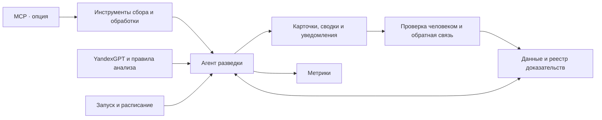

# Окружение агента разведки

Текстовая версия Canvas «Агент разведки — окружение» в Obsidian. **Статус: рабочая схема**, 21.11.2026. «Есть» — компонент уже существует; «план» — проектируемый компонент; «опция» — подключение по необходимости.

## Схема связей

## Агент

**Цель:** превращать рыночные сигналы в проверяемые коммерческие возможности для БАШГРУПП. Вход — вопрос, период, периметр, профиль компании и версии источников. Потоки — объекты и участники; конкуренты и предложения; сырьё, технологии и партнёры. Выход — доказательства, сопоставление, ограничения и следующий шаг.

## Tools и MCP

- **План:** Yandex Search API для обнаружения источников; загрузчик разрешённых HTML, PDF и XLSX; RSS и sitemap, где доступны; извлечение текста и таблиц, OCR для сканов. Поисковый сниппет помогает найти документ, а доказательством служит фрагмент первоисточника с указанием страницы или ячейки.
- **План:** программные функции для версий, сравнения изменений, дедупликации, нормализации единиц и расчётов.
- **Опция:** MCP для доступа к поиску, документам или реестру. Серверы не выбраны. По умолчанию — чтение; для каждого инструмента задаются разрешённые операции, формат входа и выхода, таймаут и журнал вызовов. Инструменты могут работать и напрямую через Python или API.

## Модель и данные

- **Есть:** [скилл конкурентной разведки](../../../competitor_agent/skills/SKILL.md), PostgreSQL, зарегистрированные каталог и 20 кейсов. Рабочая Google-таблица и клиентская техкарта использовались для обследования.
- **План:** YandexGPT в российском контуре; версию модели, лимиты и условия обработки предстоит уточнить. Для объектов и сырья нужны собственные правила и форматы. Модель извлекает утверждения и интерпретирует материалы; программа валидирует структуру, ссылки и расчёты.
- **План:** закрытое хранилище версий документов и реестры объектов, организаций, событий и предложений. Связь: **документ → версия → фрагмент → утверждение**. Хранятся даты, контрольная сумма, статус источника и права использования. Сначала — полнотекстовый поиск, смысловой — при необходимости.

## Запуск и эксплуатация

**План:** Python, очередь и планировщик в российском контуре. Режимы: `baseline` — исходное состояние; `daily` — проверка сигналов и сбоев; `weekly` — сводка; `on_demand` — конкретный вопрос. Каждый запуск получает `run_id`, версии модели и правил, лимиты, журнал ошибок и повторов. При сбое сохраняется частичный результат с ограничениями. Частота сбора и выдачи настраивается отдельно.

## Метрики пилота

| Область | Что измеряем |
|---|---|
| Качество | Доля релевантных карточек в размеченной выборке, ошибки стадии и роли, доля выводов с доказательствами, дубли |
| Покрытие | Проверенные / запланированные источники, свежесть и недоступность |
| Эксплуатация | Длительность, ошибки, повторы, вызовы модели, токены и стоимость запуска |
| Польза | Принятые / рассмотренные карточки, запросы спецификаций, КП, сделки и время менеджера |

Цели и пороги согласуются на пилоте.

## Выдача и контроль

- **Есть:** демонстрационный веб-кабинет.
- **План:** закрытый реестр, карточки, недельная сводка и срочные сигналы по согласованным правилам. Менеджер проверяет коммерческую полезность и фиксирует итог; технолог подтверждает техническую применимость. Согласованный контекст можно передать агенту КП после подключения сценария.
- **Опции:** DataLens с доступом на чтение, корпоративный канал доставки, CRM/Планфикс после согласования доступа.
- **Правила:** доступ по ролям, разрешённые источники и бюджет запросов. Документы рассматриваются как данные. Перед публикацией проверяются источники, даты, роли, дубли и применимость; сомнительные результаты остаются на ручной проверке. Внешние действия и изменение цен — под контролем человека.
